# Awesome Claude Fable Videos

[](https://awesome.re)   [](LICENSE)

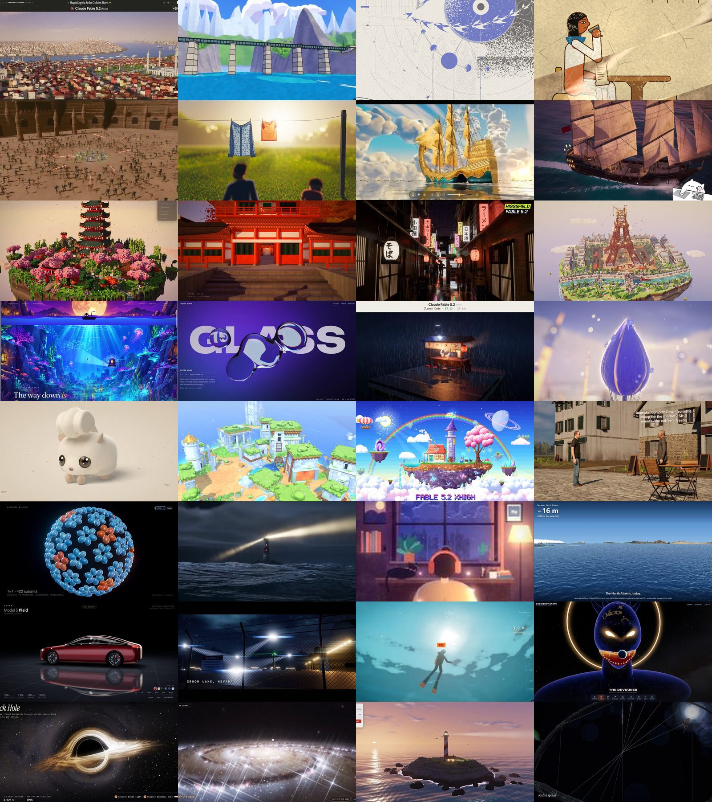

A curated list of **videos made with Claude Fable 5.2**, Anthropic's model released on November 9, 2026. Most of them are pure code, in Three.js, WebGL, Remotion or Blender driven from Python, with no image or video model involved. Short films, 3D worlds, landing pages and science visuals, each credited to its maker and linked to the post where they shared it. Where the maker published the prompt, it's copied here word for word.

**28 videos · 4 with prompts · 4 you can open yourself** · Updated 2026-11-12

Looking for games? See **[awesome-claude-fable-games](https://github.com/ummydev/awesome-claude-fable-games)**. For launch films and motion graphics made with Opus 5.5, see **[awesome-claude-motion-video](https://github.com/ummydev/awesome-claude-motion-video)**.

## Contents

- [All videos](#all-videos)
- [Films and animated shorts](#films-and-animated-shorts)
- [3D worlds and dioramas](#3d-worlds-and-dioramas)
- [Websites and interactive pages](#websites-and-interactive-pages)
- [Science, space and data](#science-space-and-data)
- [How we pick and score](#how-we-pick-and-score)
- [Add a video](#add-a-video)
- [Credits and removal](#credits-and-removal)

## All videos

Sorted by our score, then by likes on the original post. Click a frame to jump to the details.

| | Video | Maker | Likes | Views | Score |
|---|---|---|---|---|---|
| <a href="#istanbul">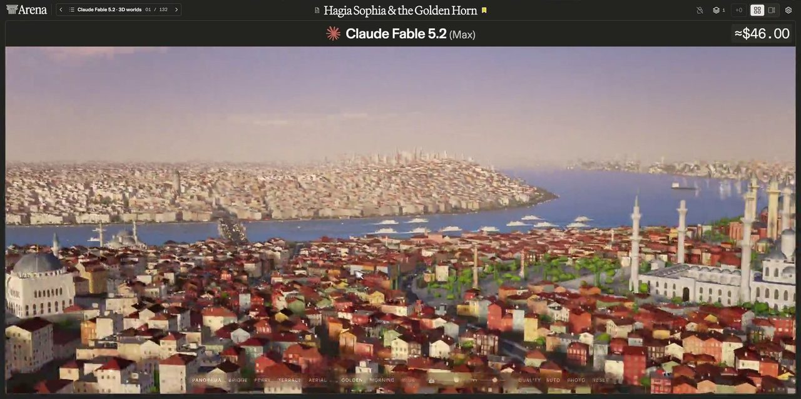</a> | **[Istanbul, built from a prompt](#istanbul)**<br><sub>3D worlds and dioramas</sub> | [Peter Gostev](https://x.com/petergostev) | 2.9K | 468.1K | 10/10 |
| <a href="#locomotive-robot-anime">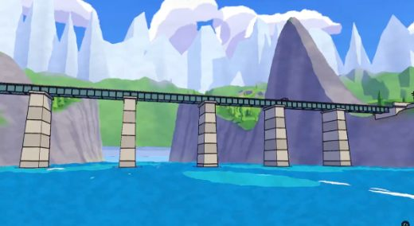</a> | **[A 90-second anime short: a steam locomotive becomes a robot](#locomotive-robot-anime)**<br><sub>Films and animated shorts</sub> | [0kncn](https://x.com/0kncn) | 409 | 69.5K | 10/10 |
| <a href="#geonosis-battle-blender">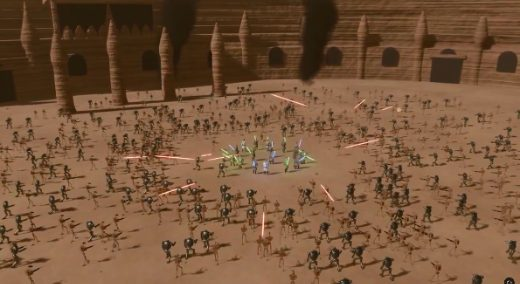</a> | **[A Star Wars battle built in Blender](#geonosis-battle-blender)**<br><sub>Films and animated shorts</sub> | [Aditya](https://x.com/adityavg13) | 292 | 44.3K | 9/10 |
| <a href="#laundry-in-the-sun"></a> | **[Laundry on a line in the afternoon light](#laundry-in-the-sun)**<br><sub>Films and animated shorts</sub> | [Dan Fein](https://x.com/dfeinition) | 210 | 8.3K | 9/10 |
| <a href="#auric-voyage">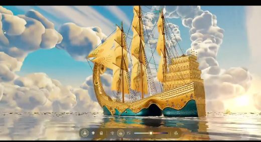</a> | **[Auric Voyage: a golden ship above the clouds](#auric-voyage)**<br><sub>3D worlds and dioramas</sub> | [Marcel](https://x.com/marcthecreatorr) | 111 | 4.8K | 9/10 |
| <a href="#pirate-ship">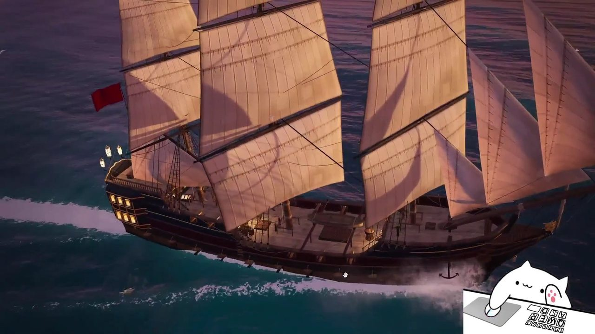</a> | **[A pirate ship sailing at sunset](#pirate-ship)**<br><sub>3D worlds and dioramas</sub> | [J A Z I I](https://x.com/notjazii) | 110 | 4.7K | 9/10 |
| <a href="#voxel-pagoda">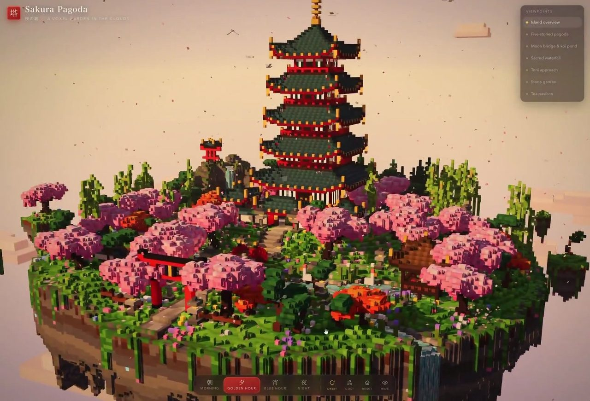</a> | **[A voxel pagoda full of tiny details](#voxel-pagoda)**<br><sub>3D worlds and dioramas</sub> | [Lumina](https://x.com/LuminaBench) | 104 | 4.5K | 9/10 |
| <a href="#fushimi-inari-travel-ad">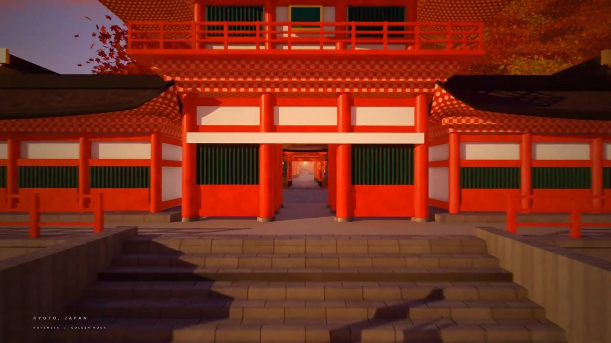</a> | **[A travel ad for Fushimi Inari in autumn](#fushimi-inari-travel-ad)**<br><sub>Films and animated shorts</sub> | [Peter Yang](https://x.com/petergyang) | 83 | 10K | 9/10 |
| <a href="#rainy-tokyo-alley">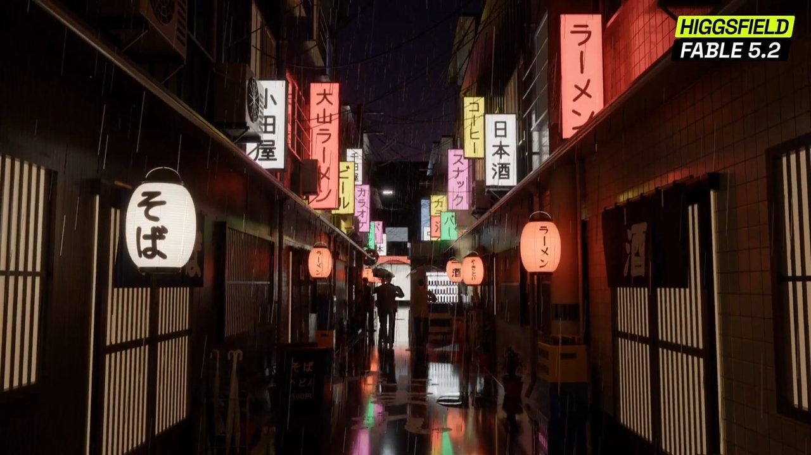</a> | **[A rainy Tokyo alley made without a video model](#rainy-tokyo-alley)**<br><sub>Films and animated shorts</sub> | [Higgsfield AI](https://x.com/higgsfield_ai) | 68 | 11.2K | 9/10 |
| <a href="#voxel-paris-1888">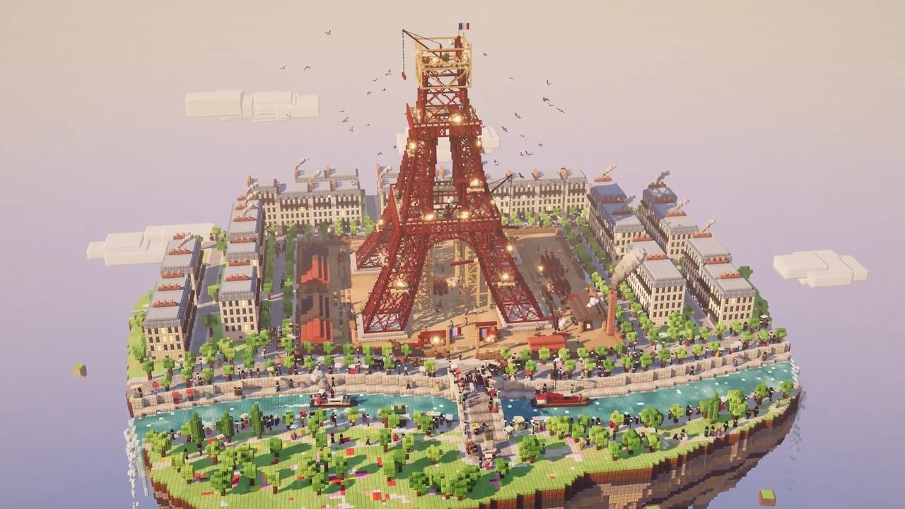</a> | **[Paris in 1888, the Eiffel Tower under construction](#voxel-paris-1888)**<br><sub>3D worlds and dioramas</sub> | [Rez](https://x.com/RezAIT00) | 41 | 4.5K | 9/10 |
| <a href="#abyssal-landing-page">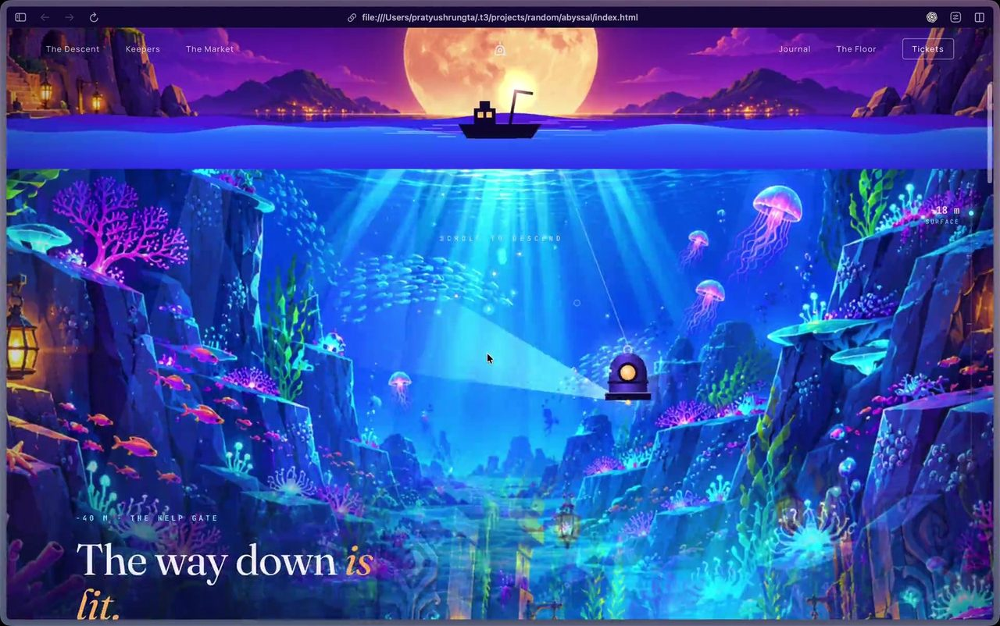</a> | **[Abyssal: a landing page that scrolls into the ocean](#abyssal-landing-page)**<br><sub>Websites and interactive pages</sub> | [Pratzyy](https://x.com/pratyushrungta) | 9 | 456 | 9/10 |
| <a href="#liquid-glass-type"></a> | **[Glass, amber and liquid metal type](#liquid-glass-type)**<br><sub>Websites and interactive pages</sub> | [Iliyass](https://x.com/ioTanjiro) | 6 | 282 | 9/10 |
| <a href="#night-tokyo-ramen-stall">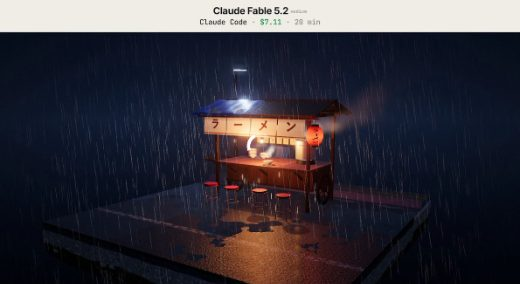</a> | **[A ramen stall on a rainy Tokyo night](#night-tokyo-ramen-stall)**<br><sub>3D worlds and dioramas</sub> | [sprinntt](https://x.com/sprinntt) | 3 | 1K | 9/10 |
| <a href="#pet-robot"></a> | **[A pet robot you could build at home](#pet-robot)**<br><sub>Films and animated shorts</sub> | [Matt Shumer](https://x.com/mattshumer_) | 151 | 138.4K | 8/10 |
| <a href="#floating-pixel-island">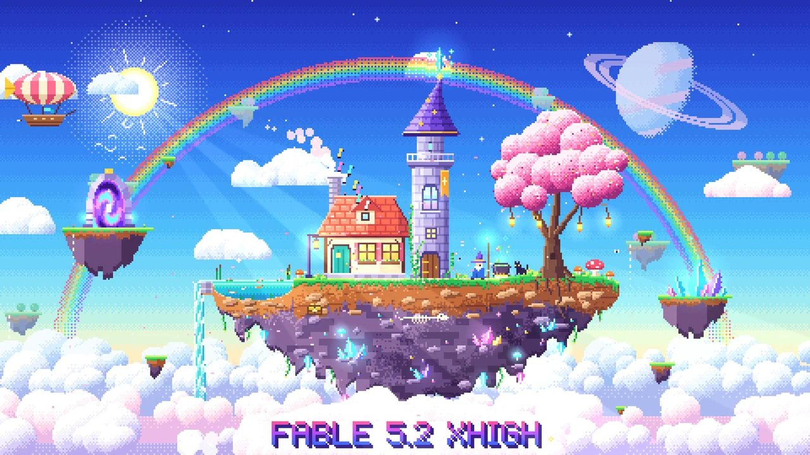</a> | **[A floating pixel island](#floating-pixel-island)**<br><sub>3D worlds and dioramas</sub> | [JUMPERZ](https://x.com/jumperz) | 75 | 3K | 8/10 |
| <a href="#talking-village">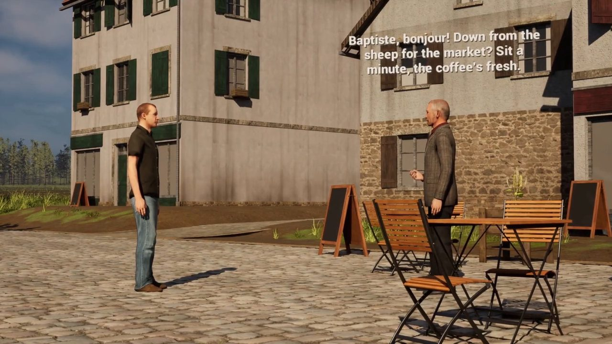</a> | **[A European village where every character thinks](#talking-village)**<br><sub>3D worlds and dioramas</sub> | [Matthew Berman](https://x.com/MatthewBerman) | 61 | 5.4K | 8/10 |
| <a href="#virus-capsid">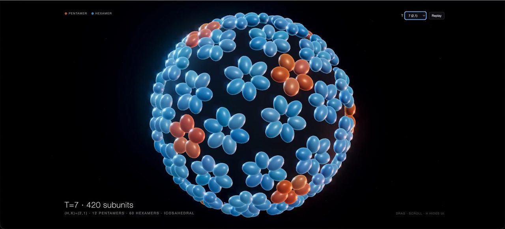</a> | **[A virus shell assembling itself](#virus-capsid)**<br><sub>Science, space and data</sub> | [Tekon Burns](https://x.com/TekonBurns) | 55 | 3.8K | 8/10 |
| <a href="#lighthouse-in-a-storm">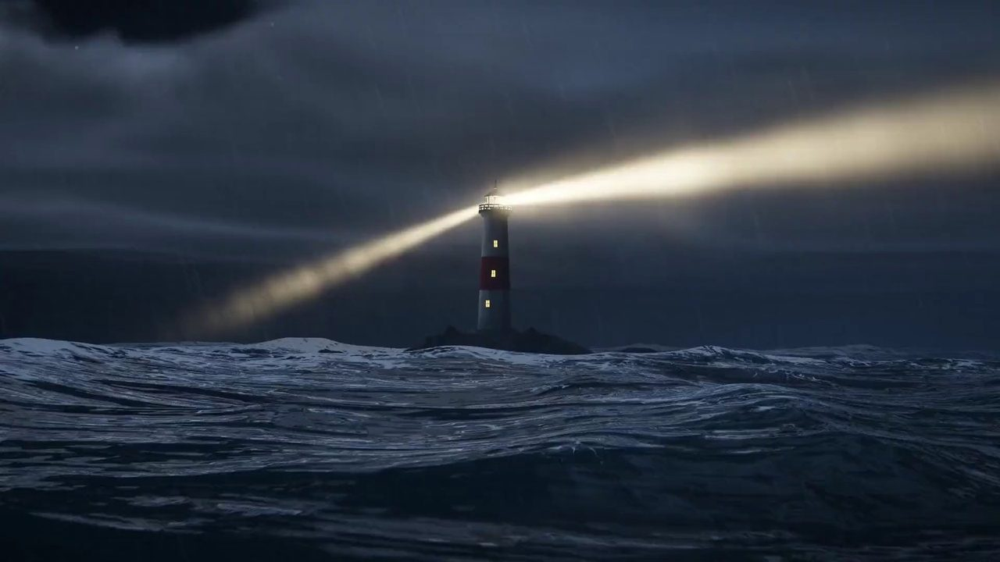</a> | **[A lighthouse in a storm](#lighthouse-in-a-storm)**<br><sub>Films and animated shorts</sub> | [rohit](https://x.com/rohit3a) | 52 | 1.9K | 8/10 |
| <a href="#piano-boy-short"></a> | **[A 46-second film with zero generated images](#piano-boy-short)**<br><sub>Films and animated shorts</sub> | [Cube](https://x.com/cube__lol) | 14 | 624 | 8/10 |
| <a href="#drained-ocean">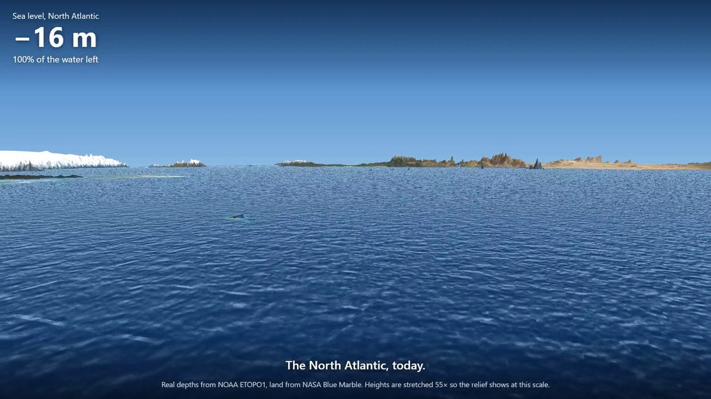</a> | **[What the Atlantic looks like with the water drained](#drained-ocean)**<br><sub>Science, space and data</sub> | [Gul Saeed Khattak](https://x.com/Ldataengineer) | 4 | 2.3K | 8/10 |
| <a href="#car-configurator">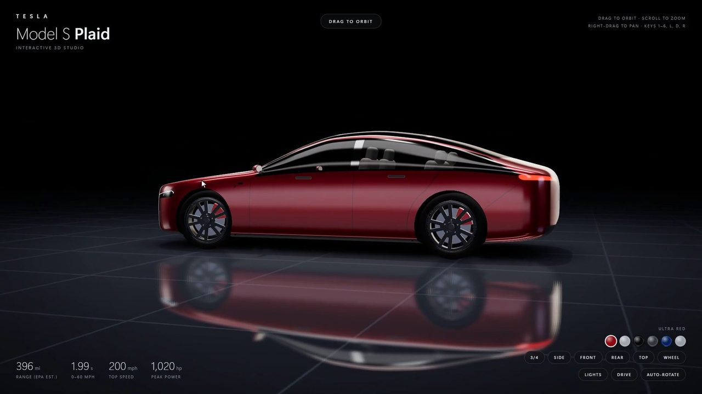</a> | **[A car configurator made on medium thinking](#car-configurator)**<br><sub>Websites and interactive pages</sub> | [Rez](https://x.com/RezAIT00) | 3 | 598 | 8/10 |
| <a href="#ufo-area-51">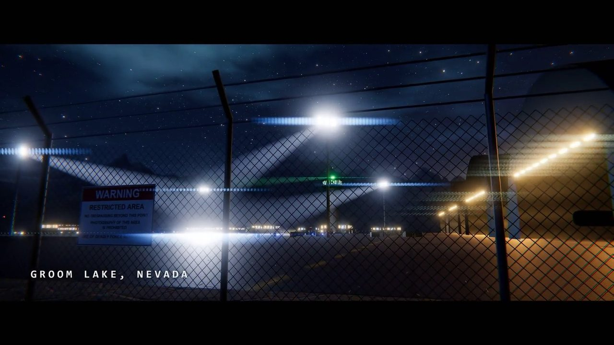</a> | **[A UFO lands at Area 51](#ufo-area-51)**<br><sub>Films and animated shorts</sub> | [Dante](https://x.com/danteeonsol) | 3 | 209 | 8/10 |
| <a href="#deep-sea-dive">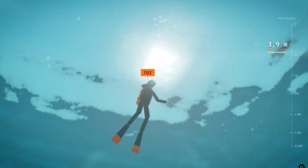</a> | **[A dive from the surface to 40 metres](#deep-sea-dive)**<br><sub>Science, space and data</sub> | [g_beyrouti](https://x.com/g_beyrouti) | 1 | 94 | 8/10 |
| <a href="#doomsday-earth">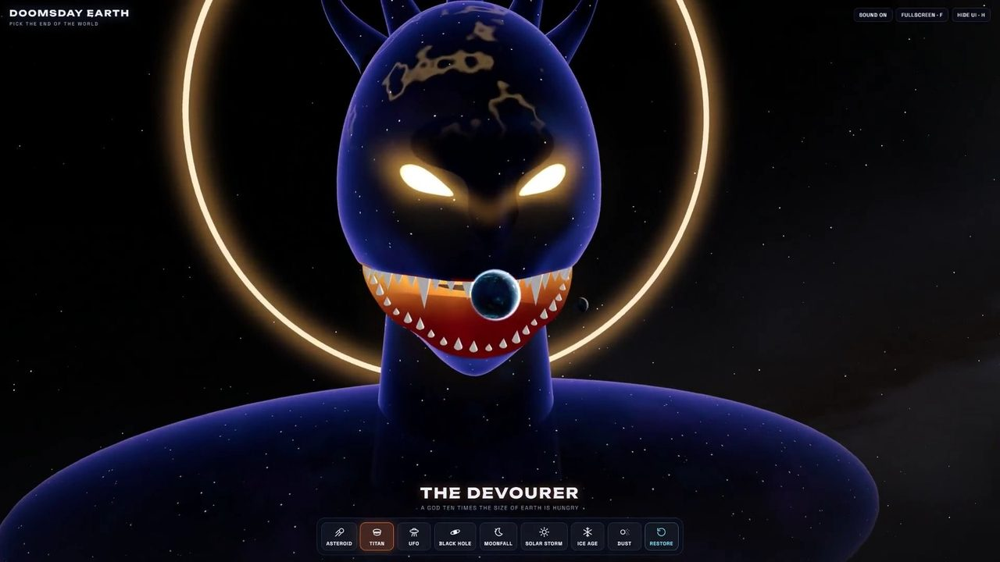</a> | **[Doomsday Earth: eight ways to destroy the planet](#doomsday-earth)**<br><sub>Websites and interactive pages</sub> | [0xVe1vet](https://x.com/0xVe1vet) |  | 162 | 8/10 |
| <a href="#pocket-black-hole">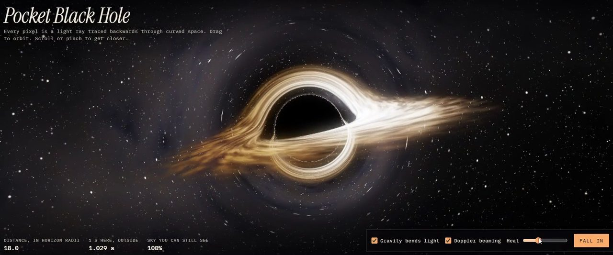</a> | **[A pocket black hole](#pocket-black-hole)**<br><sub>Science, space and data</sub> | [Paul Gegenyi](https://x.com/paulgrowthlab) |  | 43 | 8/10 |
| <a href="#galaxy-dive">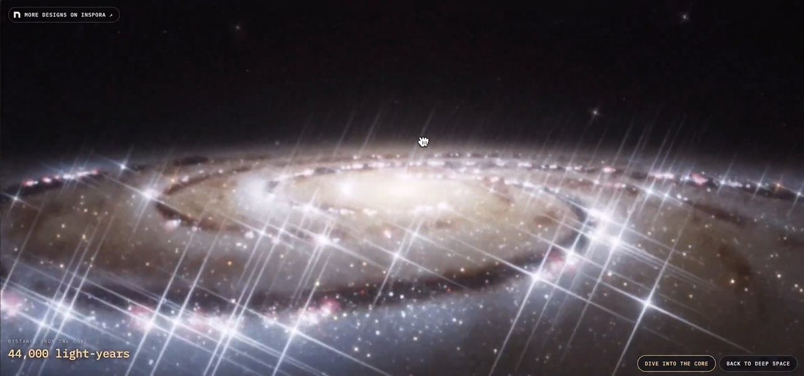</a> | **[Fly into a spiral galaxy](#galaxy-dive)**<br><sub>Science, space and data</sub> | [Marko Vineli](https://x.com/handsher_NGU) | 24 | 1.6K | 7/10 |
| <a href="#lighthouse-at-sunset">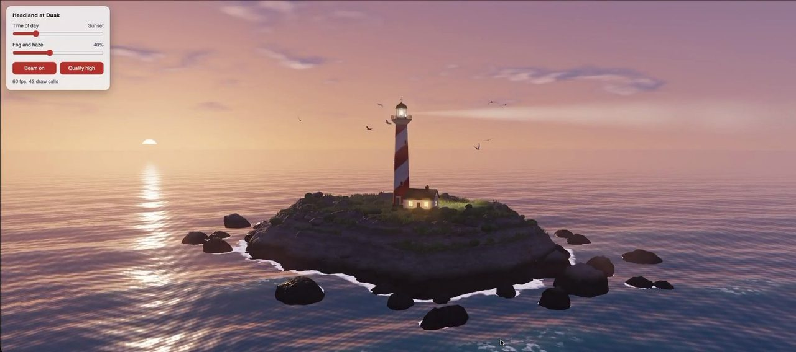</a> | **[A photorealistic lighthouse at sunset](#lighthouse-at-sunset)**<br><sub>3D worlds and dioramas</sub> | [Not Harris](https://x.com/viewsfrom02108) | 2 | 305 | 7/10 |
| <a href="#spider-web-logo">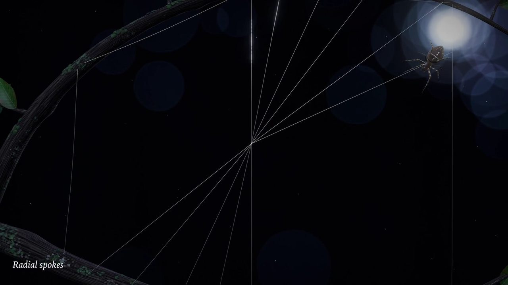</a> | **[A spider weaves the Claude logo into its web](#spider-web-logo)**<br><sub>Films and animated shorts</sub> | [sudoPhoeniX](https://x.com/sudoPhoeniX) | 1 | 79 | 7/10 |

## Films and animated shorts

### A 90-second anime short: a steam locomotive becomes a robot
<a id="locomotive-robot-anime"></a>

<p><a href="https://x.com/0kncn/status/2119901782482543073"></a> <a href="https://x.com/0kncn/status/2119901782482543073">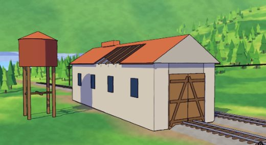</a> <a href="https://x.com/0kncn/status/2119901782482543073">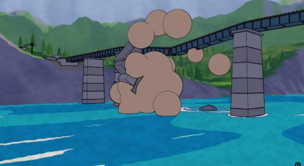</a></p>

Hand-drawn-looking 2D anime made from one prompt: Fable built every shot in Blender from Python, rendered it in Eevee and inked each frame in a second pass. The iron bridge, engine shed, explosions and smoke are all its work, and so is the score, written note by note with numpy at 144 bpm.

- **Watch:** [the original post on X](https://x.com/0kncn/status/2119901782482543073) (409 likes, 69.5K views), posted 2026-11-09
- **Made by:** [@0kncn](https://x.com/0kncn)
- **How:** Fable 5.2 + Blender (Python) + numpy for the music

<details><summary><b>Prompt</b> (verbatim from the maker, <a href="https://x.com/0kncn/status/2119901786060259612">source</a>, click to expand)</summary>

```text
Create a 2D anime short. It must look completely like real Japanese anime, as if it were taken directly from a finished theatrical anime film. This is traditional-looking, hand-drawn 2D anime, not a 3D animation, a moving illustration, or a stylized web graphic.

Build everything in Blender from Python, render it in Eevee, then ink and paint every frame in a second pass. Deliver one 1920x1080, 24 fps MP4 with a synthesized soundtrack. Use any tools, libraries, references, guides, literally anything, as long as the final result looks 100% like hand-drawn 2D anime.

Use theatrical anime as the art style reference for the design, line work, painted backgrounds, color and atmosphere. The film is 90 seconds long (2160 frames), in 42 shots. Its hero is a steam locomotive that transforms into a robot. No people appear in the film.

HERO
No. 9, a 1940s 2-8-2 freight locomotive with a four-axle tender, 23 m long, asleep for decades in a mountain engine shed: matte black boiler with rust runs, faded red wheel centres and buffer beam, brass number plate "9", one large headlamp, two amber marker lamps, moss on the running boards, ivy through the cab windows, and a stork's nest on the cab roof. As a robot it stands 21 m tall with its shoulders at 17 m. It is an original design, not a character from any existing series. It moves on twos, slow and heavy. Its wheels never slip and its feet never slide.

TRANSFORM
One transformation, at full speed, 120 frames, in five stages of 24 frames. Every part is rigid: nothing stretches, nothing vanishes, nothing appears. Each part travels on a hinge or a slide you can see.
1. Legs: the tender uncouples, splits lengthwise and swings down; its two bogies lock as feet, the coal stays in bunkers on the calves.
2. Hips: the cab drops and widens into the pelvis; the trailing truck folds onto the lower back.
3. Torso: the boiler tilts upright, firebox at the waist, smokebox at the top; the chimney and steam dome end on the upper back and keep venting.
4. Arms: the running boards swing out with the cylinders as shoulders, the piston and connecting rods as forearms, and hands with three fingers and a thumb unfolding from the valve gear; the front driving wheels ride up as shoulder discs, the rear ones fold to hips and knees.
5. Head: the smokebox door hinges forward as the chest plate with the headlamp at its centre; a riveted helmet rises from the smokebox with one dark visor slit and the two marker lamps as amber eyes; the cowcatcher folds up as a collar.
The cab roof panel rides up to the right shoulder and carries the stork's nest, never tilted more than 10 degrees.
Stages 1-3 happen on the rails, with the first strides landing on the ballast either side of the track. Stages 4-5 happen in the air.

WORLD
A single-track mountain railway at real scale. At the top, an ore mine with a loading bunker and a rake of twelve four-wheel hopper wagons. The line descends through larch forest and a short rock tunnel to a viaduct: seven 18 m steel girder spans on stone piers, 126 m long, the deck 17 m above a turquoise meltwater river 3 m deep. Beyond it, a small station: a stone engine shed, a water tower, a semaphore signal with an alarm bell, a signal box, a siding ending in a sand drag. Snow peaks behind, a cliff face above the viaduct, telegraph poles along the whole line.

STORY
A clear spring morning in the valley. Meltwater loosens the cliff: a rockfall hits the middle pier of the viaduct, the pier collapses into the river and the two girders it carried sag into a V, held only by the rails. Up at the mine the shock snaps a coupling and the twelve loaded wagons start to roll downhill, unmanned. At the station the semaphore drops to danger and the bell rings. In the dark shed the firebox glows, the pressure needle climbs, the headlamp lights; the stork flies up. No. 9 bursts through the shed doors tearing ivy and rust, and charges up the grade with the wagons coming down the other side. On the approach it transforms at full speed, leaps from the abutment, lands crouched in the river, wades to the fallen pier, and lifts the sagging joint onto its shoulders and raised hands. The wagons hit the viaduct: it sinks 0.3 m as each one passes over and holds. The rake runs through the station into the sand drag and stops. No. 9 does not come back out. It locks its knees and stays as the new pier. The steam thins, the stork returns to its nest, the visor dims.

LIGHT
High-key anime light, never murky: a morning sun from the south-east, a saturated cobalt sky, white cumulus with lavender shadows, snow peaks with blue shadows, fresh green larch, a turquoise river with drawn white water. Light only changes with a cause you can see: rock dust dims the gorge for 3 seconds, steam whites out a frame, the firebox throws orange onto the shed walls. Cel light with hard shadows, gouache backgrounds, ink lines on every machine, rail and building, effects drawn on twos: steam as inked rolling shapes with a flat shadow tone, water as inked sheets with foam crowns, dust as drawn clouds, never particle mush.

SOUND
A synthesized orchestra on a 144 bpm grid: one beat is 10 frames, and every cut lands on a multiple of 5 frames. A hopeful theme on clarinet and horn, the collapse in E minor, a 12/8 chase with the exhaust chuff as percussion at four beats per wheel revolution, a heavy 3/4 for the hold with one low drum per wagon. 16 hits land exactly on the picture: the rockfall, the pier, the coupling, the signal arm, the shed doors, each transformation lock, the landing, the lift, the first and last wagon. The steam whistle is heard twice: once on waking, once on the hold.

FORMAT
Write the film as a Python story clock: one state per frame for every pose, camera, wheel angle, rod position, transformation part, wagon, effect and sound cue.

CHECKS
Before the final render a script tests every frame on the real meshes: no part of No. 9 goes through another part, in either form or at any frame of the transformation; the total volume of its parts is the same in both forms; every wheel on a rail turns exactly as far as it travels; planted feet do not move; No. 9 never goes through the track, the shed, the viaduct or the riverbed; the wagons stay on the rails and never touch each other except at the couplings; the camera never enters a mesh, the cliff or the water; nothing jumps between frames.
```

</details>

<sub>Our score: 10/10 for visuals, polish and ambition.</sub>

### A Star Wars battle built in Blender
<a id="geonosis-battle-blender"></a>

<p><a href="https://x.com/adityavg13/status/2119903463735799971"></a> <a href="https://x.com/adityavg13/status/2119903463735799971">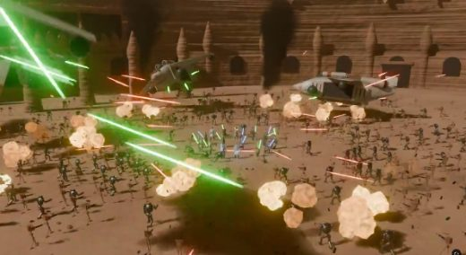</a> <a href="https://x.com/adityavg13/status/2119903463735799971">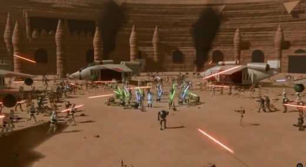</a></p>

The maker's Star Wars Blender Bench, which they run on every new model: the first battle of Geonosis, with over a thousand droids, gunships and laser fire in the arena.

- **Watch:** [the original post on X](https://x.com/adityavg13/status/2119903463735799971) (292 likes, 44.3K views), posted 2026-11-09
- **Made by:** Aditya ([@adityavg13](https://x.com/adityavg13))
- **How:** Fable 5.2 driving Blender; one prompt, 1.5 hours including a 20-minute render
- **Prompt:** One prompt; the maker hasn't posted it.

<sub>Our score: 9/10 for visuals, polish and ambition.</sub>

### Laundry on a line in the afternoon light
<a id="laundry-in-the-sun"></a>

<p><a href="https://x.com/dfeinition/status/2119886262211625062"></a> <a href="https://x.com/dfeinition/status/2119886262211625062"></a> <a href="https://x.com/dfeinition/status/2119886262211625062"></a></p>

Two people watch shirts flap on a washing line in a sunny field. The folds, the light through the fabric, the camera and the sound are all code.

- **Watch:** [the original post on X](https://x.com/dfeinition/status/2119886262211625062) (210 likes, 8.3K views), posted 2026-11-09
- **Made by:** Dan Fein ([@dfeinition](https://x.com/dfeinition))

<sub>Our score: 9/10 for visuals, polish and ambition.</sub>

### A travel ad for Fushimi Inari in autumn
<a id="fushimi-inari-travel-ad"></a>

<p><a href="https://x.com/petergyang/status/2119886560992854431"></a> <a href="https://x.com/petergyang/status/2119886560992854431">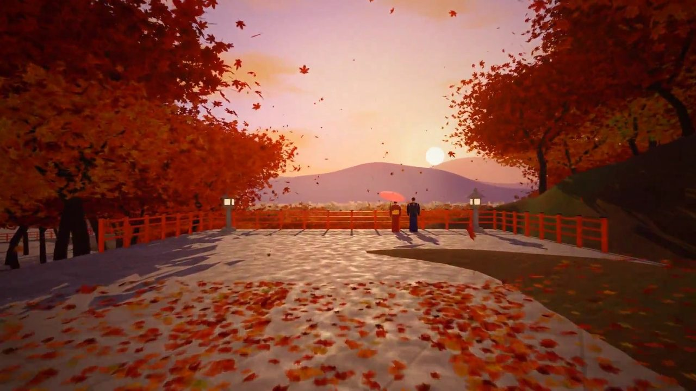</a> <a href="https://x.com/petergyang/status/2119886560992854431"></a></p>

A 20-second travel ad for the Kyoto shrine in autumn: the gate, a run through the red torii tunnel and a title card at sunset, entirely in code with the music included.

- **Watch:** [the original post on X](https://x.com/petergyang/status/2119886560992854431) (83 likes, 10K views), posted 2026-11-09
- **Made by:** Peter Yang ([@petergyang](https://x.com/petergyang))
- **More:** The maker's YouTube video runs the same prompt on Opus 5.5: https://youtu.be/SsSKJA0EHD4

<sub>Our score: 9/10 for visuals, polish and ambition.</sub>

### A rainy Tokyo alley made without a video model
<a id="rainy-tokyo-alley"></a>

<p><a href="https://x.com/higgsfield_ai/status/2119905141822484595"></a> <a href="https://x.com/higgsfield_ai/status/2119905141822484595">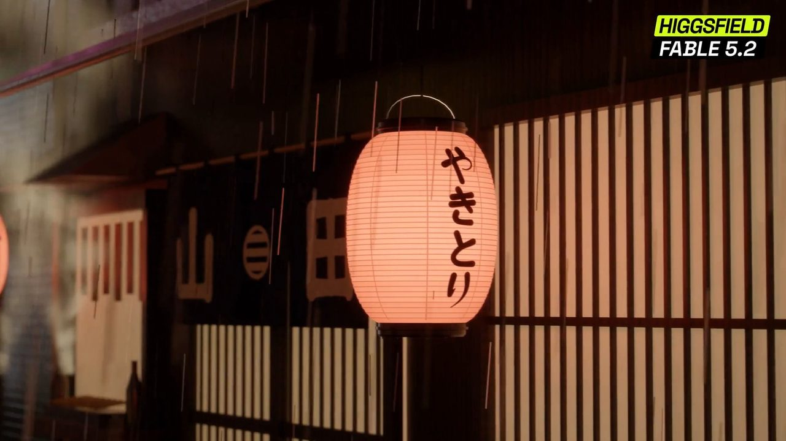</a> <a href="https://x.com/higgsfield_ai/status/2119905141822484595">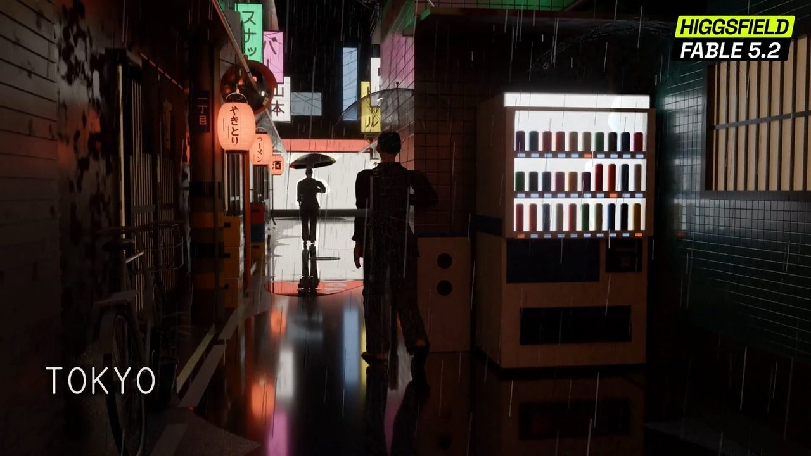</a></p>

Rain, puddles and neon reflections in a narrow Tokyo alley, with a street mirror that really reflects and Japanese signs you can read. Built in code by Fable 5.2.

- **Watch:** [the original post on X](https://x.com/higgsfield_ai/status/2119905141822484595) (68 likes, 11.2K views), posted 2026-11-09
- **Made by:** Higgsfield AI ([@higgsfield_ai](https://x.com/higgsfield_ai))
- **How:** Fable 5.2 through Higgsfield's MCP (posted by Higgsfield)

<sub>Our score: 9/10 for visuals, polish and ambition.</sub>

### A pet robot you could build at home
<a id="pet-robot"></a>

<p><a href="https://x.com/mattshumer_/status/2119889518564147409"></a> <a href="https://x.com/mattshumer_/status/2119889518564147409"></a> <a href="https://x.com/mattshumer_/status/2119889518564147409">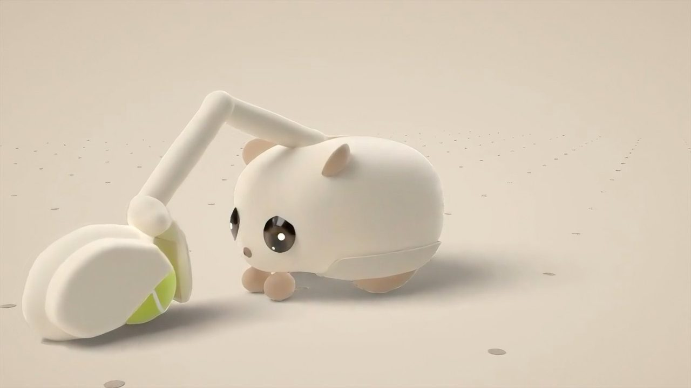</a></p>

Asked to design a robot he could actually build in his apartment, Fable came back with a round little pet robot, animated as it wakes up, swings its arm and plays with a tennis ball.

- **Watch:** [the original post on X](https://x.com/mattshumer_/status/2119889518564147409) (151 likes, 138.4K views), posted 2026-11-09
- **Made by:** Matt Shumer ([@mattshumer_](https://x.com/mattshumer_))

<sub>Our score: 8/10 for visuals, polish and ambition.</sub>

### A lighthouse in a storm
<a id="lighthouse-in-a-storm"></a>

<p><a href="https://x.com/rohit3a/status/2119899684999487954"></a> <a href="https://x.com/rohit3a/status/2119899684999487954"></a> <a href="https://x.com/rohit3a/status/2119899684999487954">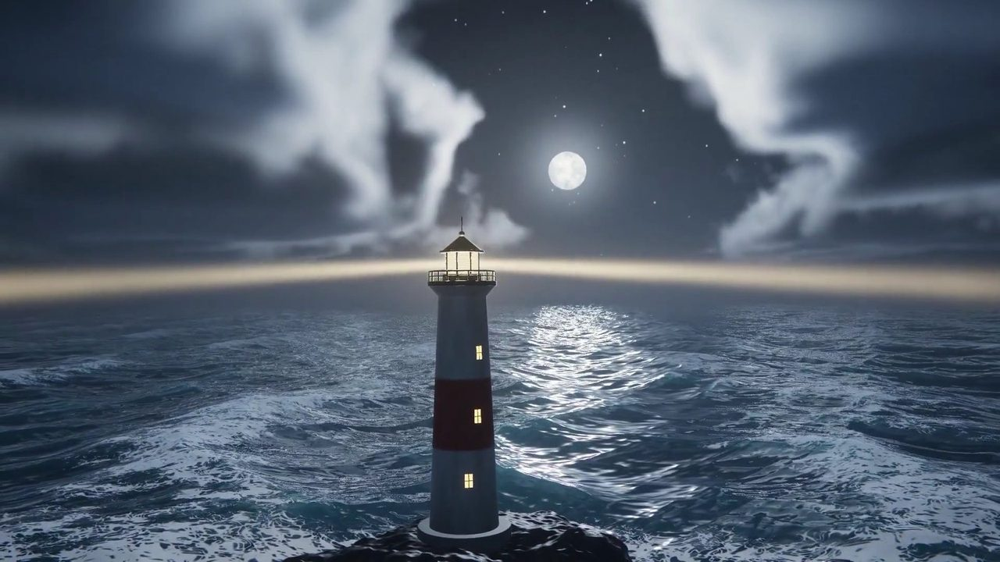</a></p>

A lighthouse sweeps its beam over a heaving night sea until the clouds part around the moon. The video has sound.

- **Watch:** [the original post on X](https://x.com/rohit3a/status/2119899684999487954) (52 likes, 1.9K views), posted 2026-11-09
- **Made by:** rohit ([@rohit3a](https://x.com/rohit3a))
- **How:** Fable 5.2 on high effort

<sub>Our score: 8/10 for visuals, polish and ambition.</sub>

### A 46-second film with zero generated images
<a id="piano-boy-short"></a>

<p><a href="https://x.com/cube__lol/status/2119904449556832554"></a> <a href="https://x.com/cube__lol/status/2119904449556832554"></a> <a href="https://x.com/cube__lol/status/2119904449556832554">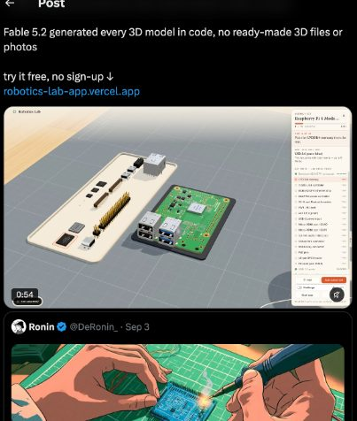</a></p>

A boy at a piano, as a short animated film. Every frame was drawn and every note played by code Fable 5.2 wrote; no image or video model was used.

- **Watch:** [the original post on X](https://x.com/cube__lol/status/2119904449556832554) (14 likes, 624 views), posted 2026-11-09
- **Made by:** Cube ([@cube__lol](https://x.com/cube__lol))
- **How:** Fable 5.2, drawing and music in code

<sub>Our score: 8/10 for visuals, polish and ambition.</sub>

### A UFO lands at Area 51
<a id="ufo-area-51"></a>

<p><a href="https://x.com/danteeonsol/status/2119887623070077213"></a> <a href="https://x.com/danteeonsol/status/2119887623070077213"></a> <a href="https://x.com/danteeonsol/status/2119887623070077213">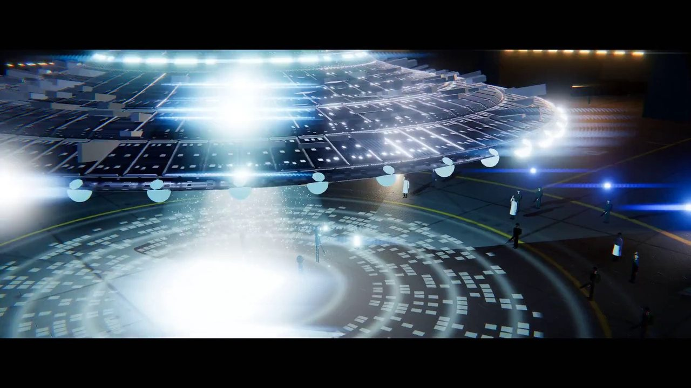</a></p>

A 30-second, five-shot film written in three.js and Remotion: a saucer descends on Groom Lake and greets the people waiting below. No imported models, no textures, no stock audio; 4K at 30 fps.

- **Watch:** [the original post on X](https://x.com/danteeonsol/status/2119887623070077213) (3 likes, 209 views), posted 2026-11-09
- **Made by:** Dante ([@danteeonsol](https://x.com/danteeonsol))
- **How:** three.js + Remotion

**Prompt** (verbatim from the maker; the whole prompt, quoted in the post, [source](https://x.com/danteeonsol/status/2119887623070077213)):

```text
make me a 30 second video of a UFO visiting Area 51 and greeting humans, ultra detailed, cinematic lighting
```

<sub>Our score: 8/10 for visuals, polish and ambition.</sub>

### A spider weaves the Claude logo into its web
<a id="spider-web-logo"></a>

<p><a href="https://x.com/sudoPhoeniX/status/2119885209621655872"></a> <a href="https://x.com/sudoPhoeniX/status/2119885209621655872">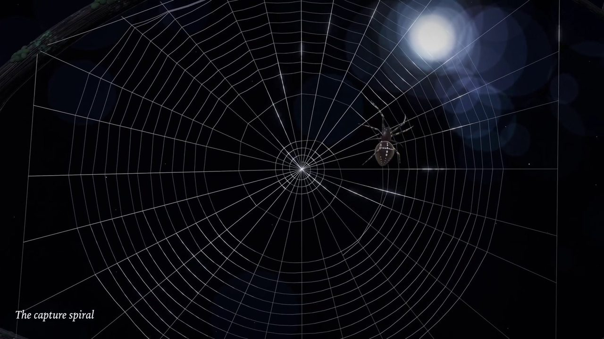</a> <a href="https://x.com/sudoPhoeniX/status/2119885209621655872">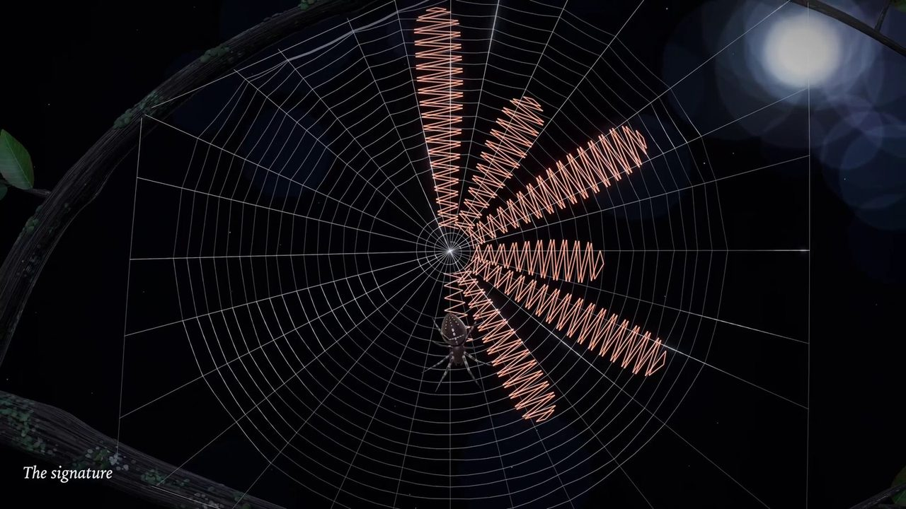</a></p>

A moonlit spider spins its web step by step, from the bridge line and radial spokes to the capture spiral, then stitches the Claude logo into the centre by dawn.

- **Watch:** [the original post on X](https://x.com/sudoPhoeniX/status/2119885209621655872) (1 likes, 79 views), posted 2026-11-09
- **Made by:** [@sudoPhoeniX](https://x.com/sudoPhoeniX)

<sub>Our score: 7/10 for visuals, polish and ambition.</sub>

## 3D worlds and dioramas

### Istanbul, built from a prompt
<a id="istanbul"></a>

<p><a href="https://x.com/petergostev/status/2119877733488394520"></a> <a href="https://x.com/petergostev/status/2119877733488394520">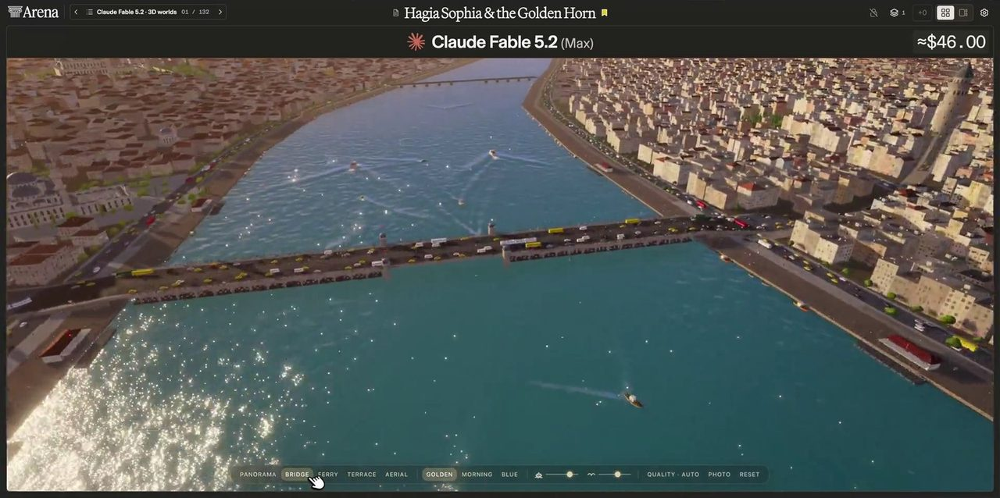</a> <a href="https://x.com/petergostev/status/2119877733488394520">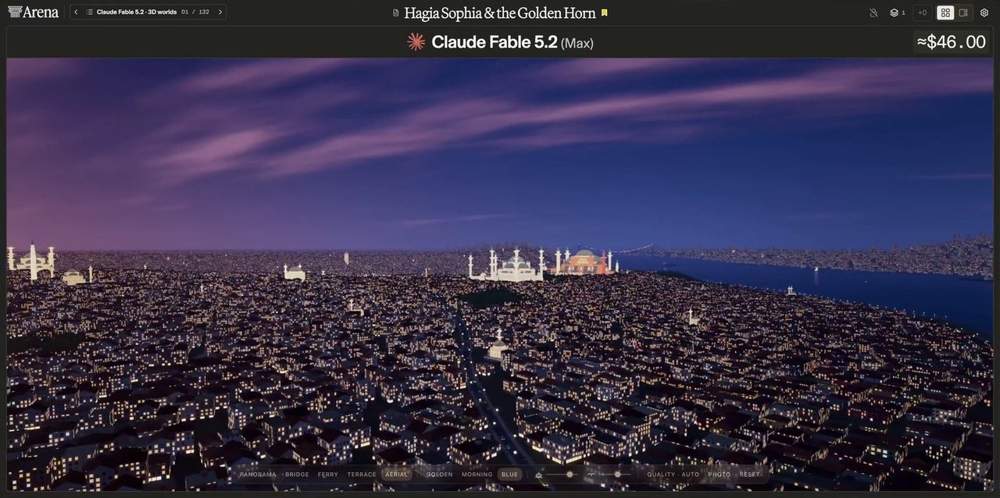</a></p>

The whole city from the air: the Hagia Sophia and the Golden Horn, ferries crossing the Bosphorus, and the skyline at dusk. Run on Fable 5.2 Max, at about $46.

- **Watch:** [the original post on X](https://x.com/petergostev/status/2119877733488394520) (2.9K likes, 468.1K views), posted 2026-11-09
- **Made by:** Peter Gostev ([@petergostev](https://x.com/petergostev))
- **How:** Fable 5.2 Max

<sub>Our score: 10/10 for visuals, polish and ambition.</sub>

### Auric Voyage: a golden ship above the clouds
<a id="auric-voyage"></a>

<p><a href="https://x.com/marcthecreatorr/status/2119890973560054072"></a> <a href="https://x.com/marcthecreatorr/status/2119890973560054072">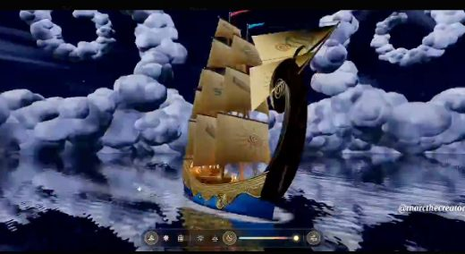</a> <a href="https://x.com/marcthecreatorr/status/2119890973560054072">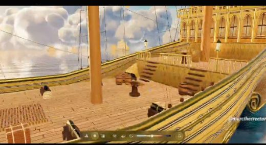</a></p>

A golden sailing ship over a sea of volumetric clouds, with a day and night cycle and a deck you can walk onto. Built in Three.js with no Blender and no outside 3D models.

- **Watch:** [the original post on X](https://x.com/marcthecreatorr/status/2119890973560054072) (111 likes, 4.8K views), posted 2026-11-09
- **Made by:** Marcel ([@marcthecreatorr](https://x.com/marcthecreatorr))
- **How:** Claude Code on medium effort, about 38 minutes and $17
- **Open it yourself:** https://claude.ai/artifact/7ge282etTXSS4edGFTFa85
- **Prompt:** The maker posted the full prompt, a long design spec, as two images in a reply. [See the reply](https://x.com/marcthecreatorr/status/2119905815872106993).

<sub>Our score: 9/10 for visuals, polish and ambition.</sub>

### A pirate ship sailing at sunset
<a id="pirate-ship"></a>

<p><a href="https://x.com/notjazii/status/2119905661505122575"></a> <a href="https://x.com/notjazii/status/2119905661505122575"></a> <a href="https://x.com/notjazii/status/2119905661505122575">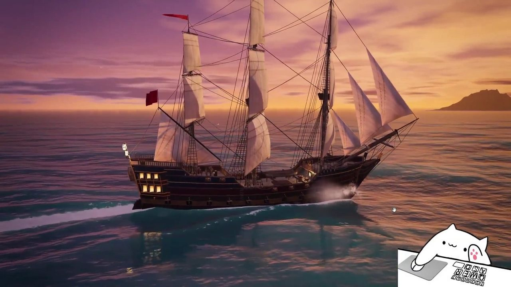</a></p>

A three-masted ship cutting through the sea at sunset, with a wake, lit cabin windows and full sails. One shot.

- **Watch:** [the original post on X](https://x.com/notjazii/status/2119905661505122575) (110 likes, 4.7K views), posted 2026-11-09
- **Made by:** J A Z I I ([@notjazii](https://x.com/notjazii))
- **How:** Fable 5.2, about 1.5 hours and 35M tokens (~$34)
- **Open it yourself:** https://tests.jazii.dev

<sub>Our score: 9/10 for visuals, polish and ambition.</sub>

### A voxel pagoda full of tiny details
<a id="voxel-pagoda"></a>

<p><a href="https://x.com/LuminaBench/status/2119907096636657696"></a> <a href="https://x.com/LuminaBench/status/2119907096636657696">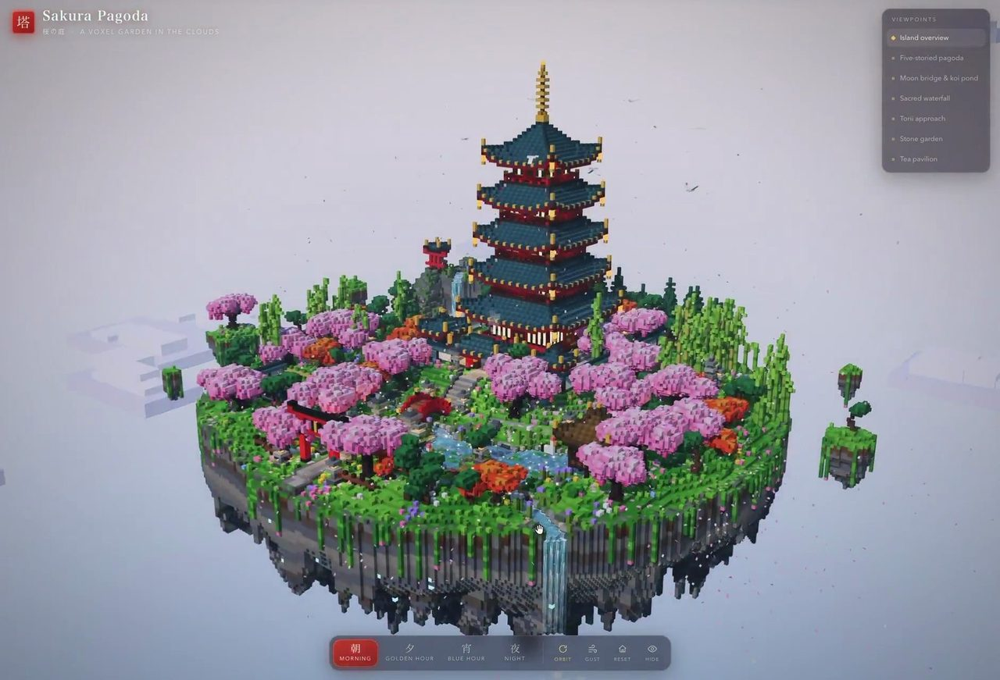</a> <a href="https://x.com/LuminaBench/status/2119907096636657696">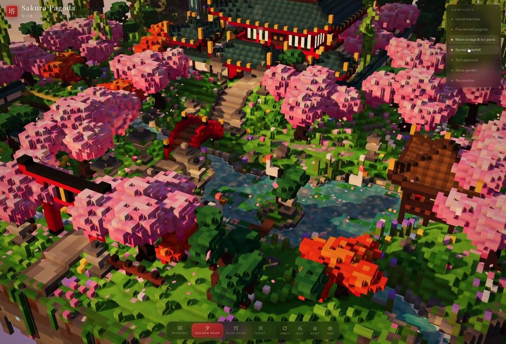</a></p>

A floating voxel island with a five-storey pagoda, cherry blossoms, ponds and lanterns that light up at night. The camera keeps finding more detail the closer it gets.

- **Watch:** [the original post on X](https://x.com/LuminaBench/status/2119907096636657696) (104 likes, 4.5K views), posted 2026-11-09
- **Made by:** Lumina ([@LuminaBench](https://x.com/LuminaBench))
- **How:** Fable 5.2 on high effort (the maker calls it the sweet spot)

<sub>Our score: 9/10 for visuals, polish and ambition.</sub>

### Paris in 1888, the Eiffel Tower under construction
<a id="voxel-paris-1888"></a>

<p><a href="https://x.com/RezAIT00/status/2119894257519767656"></a> <a href="https://x.com/RezAIT00/status/2119894257519767656">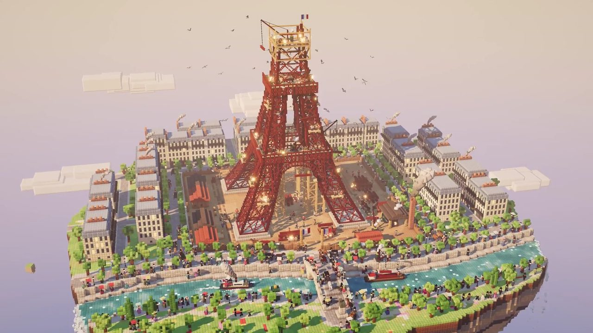</a> <a href="https://x.com/RezAIT00/status/2119894257519767656">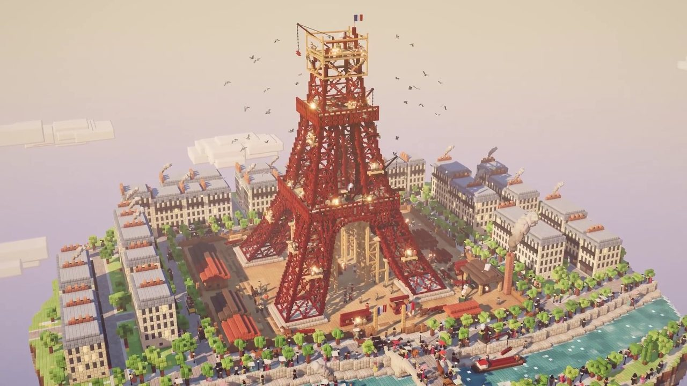</a></p>

A floating voxel diorama of Paris with the Eiffel Tower half built: cranes lift girders, riveting teams spark, carts cross the Champ de Mars and a riverboat steams along the Seine. One shot.

- **Watch:** [the original post on X](https://x.com/RezAIT00/status/2119894257519767656) (41 likes, 4.5K views), posted 2026-11-09
- **Made by:** Rez ([@RezAIT00](https://x.com/RezAIT00))

<details><summary><b>Prompt</b> (verbatim from the maker; posted by the maker in a reply, who credits the prompt to @semichenkko, <a href="https://x.com/RezAIT00/status/2119898136894156960">source</a>, click to expand)</summary>

```text
Build a single self-contained three.js HTML page that renders a 14-second animation (1280x720, 30fps, deterministic: expose window.renderAt(t) so every frame can be captured).  Scene: a floating voxel diorama island - Paris, 1888, the Eiffel Tower under construction. Everything is already moving on frame 1.  Island: - floating chunk with layered rock underside, the Seine curving across the front with stone quays and an arched bridge - Champ de Mars: dirt work yard, stacks of iron girders, wooden sheds, a steam engine with a smoking chimney - around it: rows of Haussmann buildings with cream walls, grey zinc roofs, chimneys, tiny trees along the boulevards  The tower (the hero): - dark reddish-brown wrought iron lattice made of thin voxel beams with real X-bracing, not solid blocks - four curved legs and the first platform finished, the second level half built, the top section only a skeleton - wooden scaffolding towers under the legs, small creeper cranes on the structure lifting girders on chains - glowing orange rivet sparks where workers hammer, small puffs of steam  Life (hundreds of tiny voxel people, ~3 voxels tall): - riveting teams on every level with hammers swinging, workers walking along beams - girders hoisted by cranes swinging slowly into place - horse-drawn carts carrying iron across the yard, crowds of onlookers in 1880s clothes with top hats and parasols - a riverboat with a smoking funnel moving along the Seine, carriages crossing the bridge, pigeons circling the tower  Camera and look: - wide view of the whole island, slow orbit (~25 degrees) with a gentle push-in toward the tower - warm late-afternoon sun, soft shadows, ambient occlusion, light haze, rounded voxels, ACES tone mapping, soft bloom on sparks
```

</details>

<sub>Our score: 9/10 for visuals, polish and ambition.</sub>

### A ramen stall on a rainy Tokyo night
<a id="night-tokyo-ramen-stall"></a>

<p><a href="https://x.com/sprinntt/status/2119906202330988961"></a> <a href="https://x.com/sprinntt/status/2119906202330988961">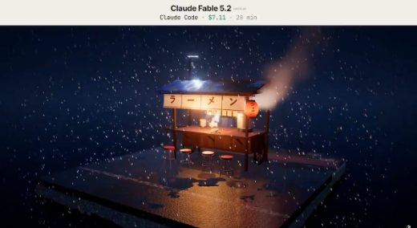</a> <a href="https://x.com/sprinntt/status/2119906202330988961">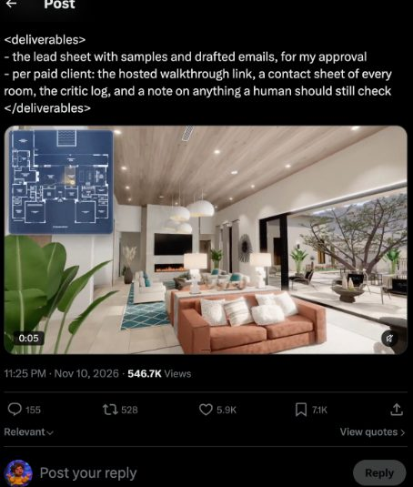</a></p>

Episode 4 of the maker's Night Tokyo series: one PROMPT.md, an empty folder and no hand edits. The scene is interactive: press T and the rain slowly turns to snow.

- **Watch:** [the original post on X](https://x.com/sprinntt/status/2119906202330988961) (3 likes, 1K views), posted 2026-11-09
- **Made by:** [@sprinntt](https://x.com/sprinntt)
- **How:** Claude Code on medium effort, about 20 minutes and $7.11
- **Prompt:** The maker uses the same PROMPT.md for every episode but hasn't posted it.

<sub>Our score: 9/10 for visuals, polish and ambition.</sub>

### A floating pixel island
<a id="floating-pixel-island"></a>

<p><a href="https://x.com/jumperz/status/2119884258789757436"></a> <a href="https://x.com/jumperz/status/2119884258789757436">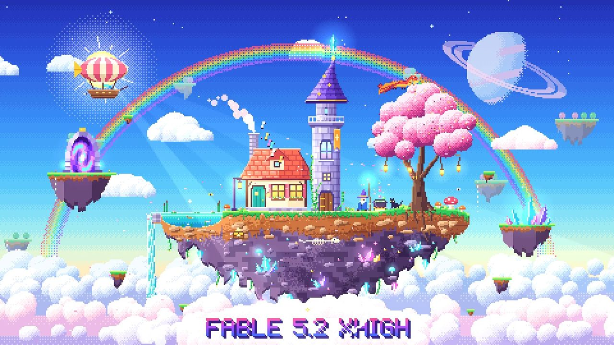</a> <a href="https://x.com/jumperz/status/2119884258789757436"></a></p>

A looping pixel-art island in the clouds with a wizard's tower, cherry trees, a rainbow, airships and a ringed planet. A single prompt on extra-high effort.

- **Watch:** [the original post on X](https://x.com/jumperz/status/2119884258789757436) (75 likes, 3K views), posted 2026-11-09
- **Made by:** [@jumperz](https://x.com/jumperz)
- **How:** Fable 5.2 on extra-high effort, one prompt

<sub>Our score: 8/10 for visuals, polish and ambition.</sub>

### A European village where every character thinks
<a id="talking-village"></a>

<p><a href="https://x.com/MatthewBerman/status/2119868638929060195"></a> <a href="https://x.com/MatthewBerman/status/2119868638929060195"></a> <a href="https://x.com/MatthewBerman/status/2119868638929060195"></a></p>

A 3D European village whose people think and talk to each other with AI, from his Fable 5.2 field test thread.

- **Watch:** [the original post on X](https://x.com/MatthewBerman/status/2119868638929060195) (61 likes, 5.4K views), posted 2026-11-09
- **Made by:** Matthew Berman ([@MatthewBerman](https://x.com/MatthewBerman))

<sub>Our score: 8/10 for visuals, polish and ambition.</sub>

### A photorealistic lighthouse at sunset
<a id="lighthouse-at-sunset"></a>

<p><a href="https://x.com/viewsfrom02108/status/2119896345729437907"></a> <a href="https://x.com/viewsfrom02108/status/2119896345729437907"></a> <a href="https://x.com/viewsfrom02108/status/2119896345729437907"></a></p>

The maker's standing lighthouse prompt, run on Fable 5.2: a striped lighthouse on a rocky island, a sweeping beam and a calm sea at sunset.

- **Watch:** [the original post on X](https://x.com/viewsfrom02108/status/2119896345729437907) (2 likes, 305 views), posted 2026-11-09
- **Made by:** Not Harris ([@viewsfrom02108](https://x.com/viewsfrom02108))

<sub>Our score: 7/10 for visuals, polish and ambition.</sub>

## Websites and interactive pages

### Abyssal: a landing page that scrolls into the ocean
<a id="abyssal-landing-page"></a>

<p><a href="https://x.com/pratyushrungta/status/2119903348354945416"></a> <a href="https://x.com/pratyushrungta/status/2119903348354945416"></a> <a href="https://x.com/pratyushrungta/status/2119903348354945416"></a></p>

A landing page for a deep-sea dive: scrolling takes you from a moonlit surface down past glowing jellyfish to a lantern-lit city and a giant eye in the dark.

- **Watch:** [the original post on X](https://x.com/pratyushrungta/status/2119903348354945416) (9 likes, 456 views), posted 2026-11-09
- **Made by:** Pratzyy ([@pratyushrungta](https://x.com/pratyushrungta))
- **How:** Fable 5.2 on low effort

<sub>Our score: 9/10 for visuals, polish and ambition.</sub>

### Glass, amber and liquid metal type
<a id="liquid-glass-type"></a>

<p><a href="https://x.com/ioTanjiro/status/2119891527438606534"></a> <a href="https://x.com/ioTanjiro/status/2119891527438606534"></a> <a href="https://x.com/ioTanjiro/status/2119891527438606534"></a></p>

A landing page where blobs of glass, amber and liquid metal push through giant headline type, each material with its own colour scheme.

- **Watch:** [the original post on X](https://x.com/ioTanjiro/status/2119891527438606534) (6 likes, 282 views), posted 2026-11-09
- **Made by:** Iliyass ([@ioTanjiro](https://x.com/ioTanjiro))

<sub>Our score: 9/10 for visuals, polish and ambition.</sub>

### A car configurator made on medium thinking
<a id="car-configurator"></a>

<p><a href="https://x.com/RezAIT00/status/2119896578987020389"></a> <a href="https://x.com/RezAIT00/status/2119896578987020389"></a> <a href="https://x.com/RezAIT00/status/2119896578987020389"></a></p>

A product page for a red electric sedan: orbit the car, change the paint and wheels, and switch to a launch view with light streaks. The maker ran it on medium effort and it took 12 minutes.

- **Watch:** [the original post on X](https://x.com/RezAIT00/status/2119896578987020389) (3 likes, 598 views), posted 2026-11-09
- **Made by:** Rez ([@RezAIT00](https://x.com/RezAIT00))
- **How:** Fable 5.2 on medium effort, 12 minutes

<sub>Our score: 8/10 for visuals, polish and ambition.</sub>

### Doomsday Earth: eight ways to destroy the planet
<a id="doomsday-earth"></a>

<p><a href="https://x.com/0xVe1vet/status/2119896809669849204"></a> <a href="https://x.com/0xVe1vet/status/2119896809669849204"></a> <a href="https://x.com/0xVe1vet/status/2119896809669849204"></a></p>

Earth in space with real NASA maps, city lights and clouds, and eight ways to end it: an asteroid strike, a solar superstorm, a god that eats the planet like an apple, and a last one that turns it to dust. Made on the first try.

- **Watch:** [the original post on X](https://x.com/0xVe1vet/status/2119896809669849204) (162 views), posted 2026-11-09
- **Made by:** [@0xVe1vet](https://x.com/0xVe1vet)

<sub>Our score: 8/10 for visuals, polish and ambition.</sub>

## Science, space and data

### A virus shell assembling itself
<a id="virus-capsid"></a>

<p><a href="https://x.com/TekonBurns/status/2119871565311660260"></a> <a href="https://x.com/TekonBurns/status/2119871565311660260"></a> <a href="https://x.com/TekonBurns/status/2119871565311660260"></a></p>

One prompt, one HTML file: 420 protein subunits assemble into a T=7 virus shell, 12 pentamers first and then 60 hexamers, the same geometry real viruses use.

- **Watch:** [the original post on X](https://x.com/TekonBurns/status/2119871565311660260) (55 likes, 3.8K views), posted 2026-11-09
- **Made by:** Tekon Burns ([@TekonBurns](https://x.com/TekonBurns))

<sub>Our score: 8/10 for visuals, polish and ambition.</sub>

### What the Atlantic looks like with the water drained
<a id="drained-ocean"></a>

<p><a href="https://x.com/Ldataengineer/status/2119896030993146101"></a> <a href="https://x.com/Ldataengineer/status/2119896030993146101"></a> <a href="https://x.com/Ldataengineer/status/2119896030993146101"></a></p>

Fable pulled real NOAA seafloor data and built a 3D flyover as the ocean drains: Britain joins Europe in the first seconds, then the Mid-Atlantic Ridge and the Puerto Rico Trench appear.

- **Watch:** [the original post on X](https://x.com/Ldataengineer/status/2119896030993146101) (4 likes, 2.3K views), posted 2026-11-09
- **Made by:** Gul Saeed Khattak ([@Ldataengineer](https://x.com/Ldataengineer))

<sub>Our score: 8/10 for visuals, polish and ambition.</sub>

### A dive from the surface to 40 metres
<a id="deep-sea-dive"></a>

<p><a href="https://x.com/g_beyrouti/status/2119904386826780943"></a> <a href="https://x.com/g_beyrouti/status/2119904386826780943"></a> <a href="https://x.com/g_beyrouti/status/2119904386826780943"></a></p>

A diver sinks past schools of fish while the sunlight, colours and torch beam change with depth, with a depth gauge on the side. The maker says it's 100% code.

- **Watch:** [the original post on X](https://x.com/g_beyrouti/status/2119904386826780943) (1 likes, 94 views), posted 2026-11-09
- **Made by:** [@g_beyrouti](https://x.com/g_beyrouti)
- **How:** Fable 5.2, code only

<sub>Our score: 8/10 for visuals, polish and ambition.</sub>

### A pocket black hole
<a id="pocket-black-hole"></a>

<p><a href="https://x.com/paulgrowthlab/status/2119890500979499382"></a> <a href="https://x.com/paulgrowthlab/status/2119890500979499382"></a> <a href="https://x.com/paulgrowthlab/status/2119890500979499382"></a></p>

The maker asked Fable 5.2 for something that would go viral and got an interactive black hole with a glowing accretion disk bent by gravitational lensing.

- **Watch:** [the original post on X](https://x.com/paulgrowthlab/status/2119890500979499382) (43 views), posted 2026-11-09
- **Made by:** Paul Gegenyi ([@paulgrowthlab](https://x.com/paulgrowthlab))
- **Open it yourself:** https://paulgegenyi.com/blackhole

<sub>Our score: 8/10 for visuals, polish and ambition.</sub>

### Fly into a spiral galaxy
<a id="galaxy-dive"></a>

<p><a href="https://x.com/handsher_NGU/status/2119910478025789655"></a> <a href="https://x.com/handsher_NGU/status/2119910478025789655"></a> <a href="https://x.com/handsher_NGU/status/2119910478025789655"></a></p>

Start outside a spiral galaxy and fly into it, with a light-year counter ticking down. The maker says it took 20 minutes.

- **Watch:** [the original post on X](https://x.com/handsher_NGU/status/2119910478025789655) (24 likes, 1.6K views), posted 2026-11-09
- **Made by:** Marko Vineli ([@handsher_NGU](https://x.com/handsher_NGU))
- **Open it yourself:** https://galaxy-dive.vercel.app

<sub>Our score: 7/10 for visuals, polish and ambition.</sub>

## How we pick and score

- The maker says the video was made with **Claude Fable 5.2**.
- It has to look good. We watch every video and leave out rough tests; the score (out of 10) is ours, for visuals, polish and ambition.
- We open every post and its replies by hand to find the tools, the effort level, the cost and any prompt the maker shared.
- Likes and views are what the original post showed when we checked it (November 11 and 12, 2026).
- The frames above are stills from each maker's own video, linked back to the post. Machine-readable list: [`data/videos.json`](data/videos.json).

## Add a video

Made a video with Claude Fable 5.2, or found a great one? Open an issue or a pull request with the post link, and the prompt if it's public.

## Credits and removal

Every video and prompt belongs to its maker; this list only links to them and credits them. If you made one of these and want it changed or removed, open an issue and we'll do it the same day.

The list text and data in this repository are under the [MIT License](LICENSE). Maintained by [Crewmark](https://crewmark.ai?utm_source=github&utm_medium=readme&utm_campaign=awesome-claude-fable-videos), which runs Claude Code and Codex as AI employees. New to the model? Read our [Claude Fable 5.2 guide](https://crewmark.ai/blog/claude-fable-5-2?utm_source=github&utm_medium=readme&utm_campaign=awesome-claude-fable-videos). Not affiliated with Anthropic.
